<div align="center">
  
  <h1>Html九尾狐 · HTML 创作工作台</h1>
  <p><strong>把文字、文件、图片和散落的 HTML 模板放进一张无限画布，经过分析、推荐、自由组合与反馈迭代，生成真正可交付的单文件 HTML。</strong></p>
  <p>个人开源项目 by <a href="https://github.com/KratosLee-6">KratosLee</a> · 默认中文 · 离线规则引擎可用 · AI 可选增强</p>
  <p><strong>简体中文</strong> · <a href="README.en.md">English</a></p>
</div>

<div align="center">

[](https://github.com/KratosLee-6/Html-ninefox/releases/tag/v0.8.3)
[](https://github.com/KratosLee-6/Html-ninefox/releases/tag/dsh-htmlninefox-v0.1.0-preview.1)
[](https://github.com/KratosLee-6/Html-ninefox/actions/workflows/build-release-packages.yml)
[](https://github.com/KratosLee-6/Html-ninefox/actions/workflows/test.yml)
[](docs/PLAN-v0.8.3.md)
[-173C8F)](docs/TEST-REPORT-v0.6.0.md)
[](pyproject.toml)
[](LICENSE)

</div>


> 当前应用包版本为 `0.8.3`（2026-10-25 发布）· [发布说明](https://github.com/KratosLee-6/Html-ninefox/releases/tag/v0.8.3) · 完整功能与架构见下。

---

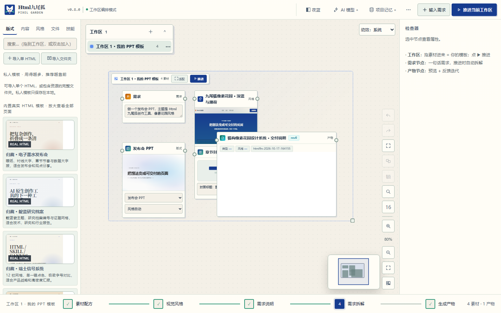
<p align="center"><b>Html九尾狐 工作台 · Pixel Garden 界面</b>（v0.8.0 实拍：素材库 · 无限画布工作区 · 检查器）</p>

## ▶ 视频

> 解说版随 v0.7.0 Release 发布，在 Release 页在线播放。

- **[解说版 · 79 秒（v0.7.0 Release 页）](https://github.com/KratosLee-6/Html-ninefox/releases/tag/v0.7.0)** — 人声解说 + 发布会式动画 + 真实操作录屏：贴入 example.com → 审核台 → 采纳 → 拆块生成 → 页面自己的正文出现在成品里。由 [huashu-art-motion](https://github.com/alchaincyf/huashu-art-motion) 引擎的 t2 发布会语法驱动，工程在 `film/v070-huashu/`（随仓库外的工作区维护）。


## 🆕 v0.8.3 · 贴入 PPT + 键盘可达（最新功能）

**一份 .pptx 走 Word 同一条管线：拆成带出处的块，先看提案再生成；整个工作台键盘可用。**

<table>
<tr>
<td width="50%"><br><b>审核台 · 吃进 .pptx</b><br>同一张界面按扩展名分流：页题成章节、要点成列表、讲稿进正文；「布局几何不还原」常驻边界清单，图表只计数，合并单元格如实上报。</td>
<td width="50%"><br><b>采纳并生成 · deck 落地</b><br>每块 evidence 带页号＋形状号可回指；人改完意图/风格/文案再生成，零新渲染路径。</td>
</tr>
</table>

- **统一契约再进一格式**：`pptx_import` 产出同一份 `intake_outline`——解析、提案、审核台、采纳全程与 Word 共用；来源是演示时默认按 deck 处理（理由随提案可见，更强的信号可覆盖）。
- **键盘可达性专项**：委托层新增 keydown 路径（`role=button` 元素 Enter/Space 与点击同表派发）；Tab 走查门禁逐个断言两页全部可见控件可键盘操作、焦点环不被拆。走查抓回两个存量真 bug：classic 五个控件自 v0.7.8 起全灭（data-action 没人消费）、项目历史一直空白（`esc` 未定义被静默吞）——已修。
- **门禁**：PPTX 解析 15 ＋ API 13（六意图真链）＋ 真浏览器 1；键盘走查 5 条；变异新增 `mutate_pptx_gates` 4/4、委托套件扩至 6/6 全 CAUGHT（preflight 六套）；全量 **808 passed / 4 skipped**。
- 详见 [v0.8.3 计划](docs/PLAN-v0.8.3.md) · [反向拆解设计](docs/DESIGN-REVERSE-INTAKE.md)。

## v0.8.2 · 界面收敛：面替代线，动效同一时钟

**不换主题、不改品牌色：把 Pixel Garden 的执行层补齐 —— 用「面」分层而不是描边围框，按钮/动效/空态按一套尺度收口。**

<table>
<tr>
<td width="50%"><br><b>工作台 · 面层结构</b><br>边界改成墨色的 10/17/30% 透明度，结构交给底色与两级柔和投影；模板缩略图 86→128px，黑标签换成 mono 小标。</td>
<td width="50%">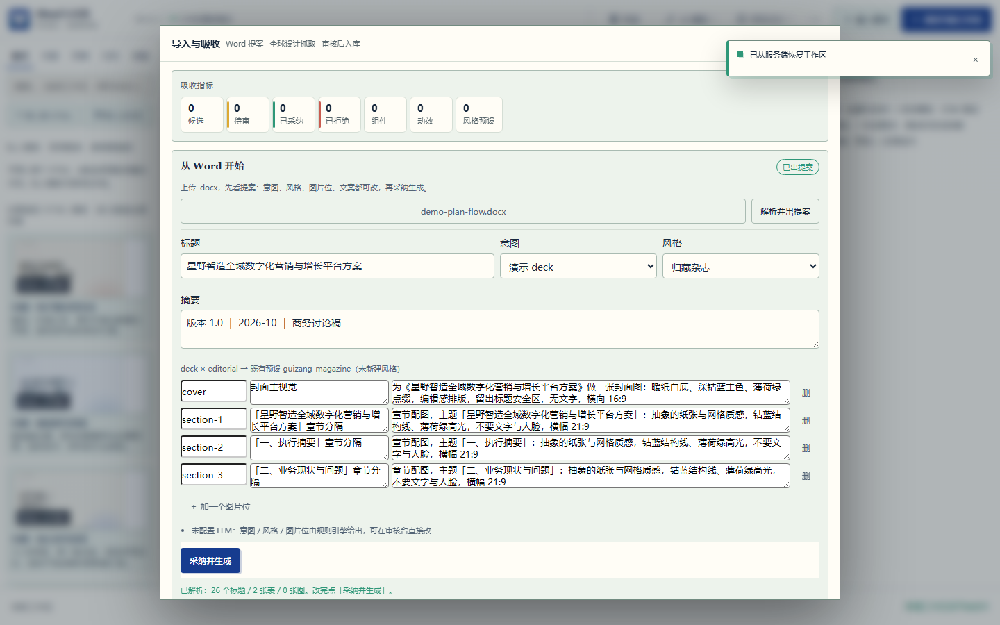<br><b>审核台 · 两层结构</b><br>区段用发丝线分隔；图片位从十二个小方框改成行分隔；主操作贴底常驻。</td>
</tr>
</table>

- **设计契约可执行**：`docs/design-contract.json` 与 `tests/test_design_contract.py` 双向比对，字号/圆角/颜色/间距/衬线任何一边改动都会红。
- **按钮系统**：32 默认 / 36 顶栏 / 40 移动；hover、active、disabled、busy、focus-visible 全部显式；一屏只一个实心主操作。
- **动效一条时钟**：instant 90 / feedback 140 / enter 180 / panel 200 / exit 140，全部来自 token；减少动效开关实测归零。
- **可访问性**：焦点环改钴蓝（陶土橙对纸白仅 2.87:1，低于 3:1）；纯图标按钮必须有可访问名与 32×32 点击区。
- **门禁**：设计契约 12 条 ＋ 按钮 4 条 ＋ 动效 8 条 ＋ 层级 6 条 ＋ 素材脱敏 3 条。

## v0.8.1 · 贴入 Word：解析 → 提案 → 采纳（v0.8.1 能力）

**一份 .docx 进工作台，先看到「它被怎么理解」的提案，人改完再生成。解析全程离线，不联网也能用。**

<table>
<tr>
<td width="50%"><br><b>审核台 · 提案全可见</b><br>意图、风格、标题、摘要、每个图片位都可改；每条建议带理由，解析边界（表格压平、图片留资产）同屏列出。</td>
<td width="50%">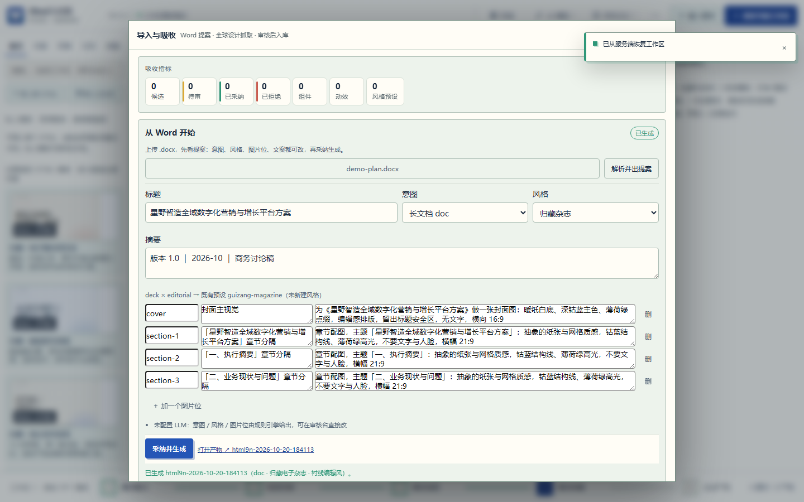<br><b>采纳并生成</b><br>一次点击落成真实项目：目录、版本、导出全走既有链路，不另造渲染路径。</td>
</tr>
<tr>
<td width="50%"><br><b>doc 产物 · 文档自己的正文</b><br>一份 26 节的示例方案（虚构主体 · 星野智造／栖木云），落成 26 节、1.2 万字符；目录行与占位符都不会混进来。</td>
<td width="50%">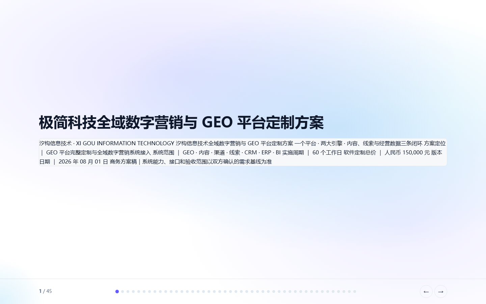<br><b>同一份文档 · 换成 deck</b><br>审核台里改意图即可换形态，不用重新上传。</td>
</tr>
</table>

- **提案先于生成**：意图 / 风格 / 图片计划 / 标题 / 摘要一次摆出来；未配模型时判据来自规则引擎并如实标 `rules`，人审完才落盘。
- **统一契约**：`intake_outline` 让解析、提案、采纳共用一份带 locator 的块——没有出处的内容进不来，边界（`limitations`）随提案一起交付。
- **不做第二条渲染路径**：采纳后转成既有分块通道的 `sections` 块，六个生成器零改动；预览与成品因此不会再漂移（v0.7.4 的旧账）。
- **边界如实上市**：表格压成文本行、图片保留为资产、Word 样式表未解析（自定义样式名退化为段落），三条都写在界面清单与接口字段里。
- **门禁**：DOCX 链 **56 条**（解析 11 · 提案 14 · 采纳 13 · 接口 14 · schema 3 · 真浏览器 1），变异 **6/6 CAUGHT**，全量 **741 passed / 4 skipped**。
- 详见 [v0.8.1 发布说明](docs/RELEASE-NOTES-v0.8.1.md) · [v0.8.1 开工记录](docs/ITERATION-v0.8.1-KICKOFF-20261018.md)。

## v0.8.0 · Word 语义导出 + 改写吸收（v0.8 主线能力）

**导出矩阵补上 Word 这一格：文档类产物切成真正的 .docx 结构；改写过的块可以一键重写。**

<table>
<tr>
<td width="50%">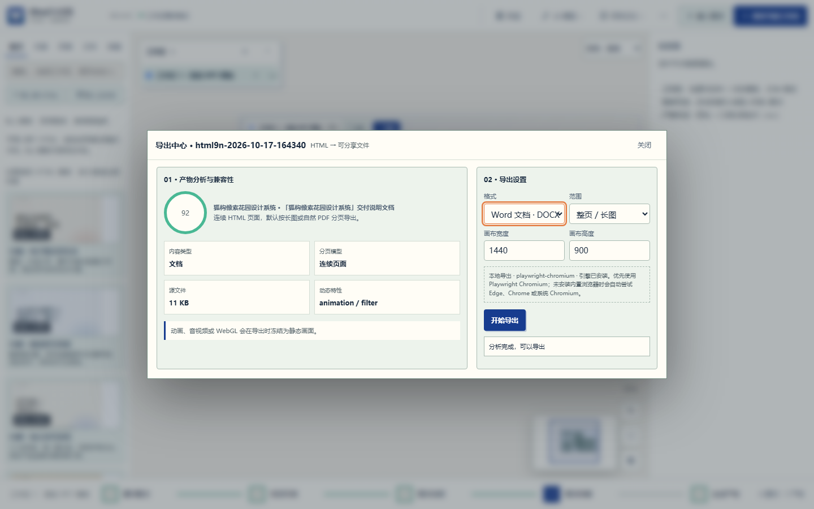<br><b>导出中心 · 选 Word 文档</b><br>doc / archdoc 走全文语义映射，deck 走讲义大纲；landing / poster / dashboard 如实引导 PDF / PNG，不假装能出 Word。</td>
<td width="50%">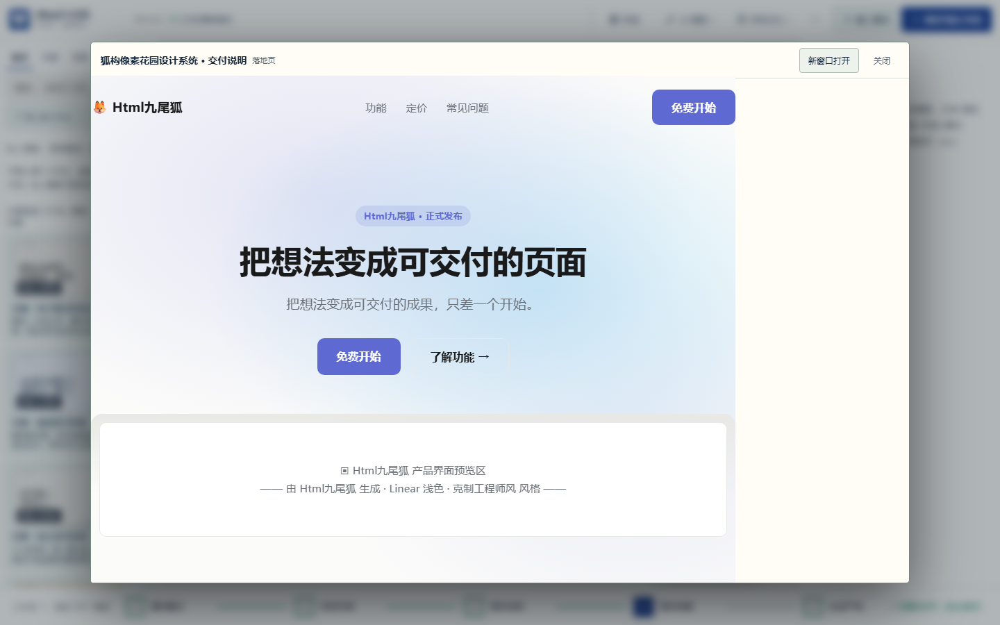<br><b>生成结果 · 真实产物预览</b><br>一条需求走完「分析 → 推荐 → 生成 → 预览」，产物在本地落盘、可导出可回滚。</td>
</tr>
<tr>
<td width="50%">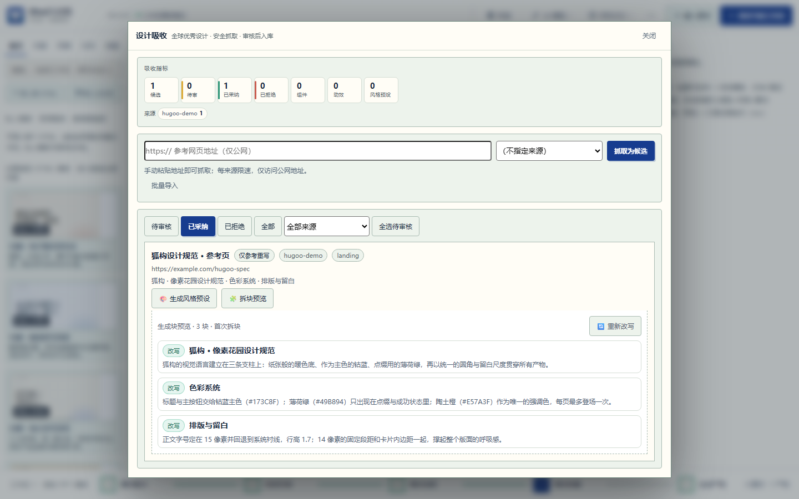<br><b>审核台 · 拆块预览</b><br>每块带 provenance 徽标（原文 / 改写 / 仅结构），改写块可一键「重新改写」。</td>
<td width="50%">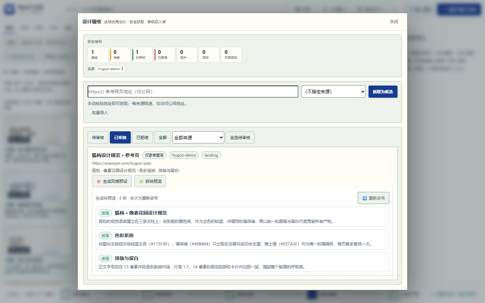<br><b>重新改写 · 绕过缓存重算</b><br>响应带 <code>retried</code> 标记，忠实度门禁照常拦截照抄。</td>
</tr>
</table>

- **语义映射（宁小勿假）**：h1–h6 → Heading 1–6、段落、ul/ol、表格、data: URI 内嵌图片（含 alt 题注）、引用、分隔线、`pre/code` 等宽段落。
- **降级清单如实上市**：外链图片不抓取（离线承诺）、CSS 配色 / 字体 / 布局不映射、非语义容器文本计数上报、界面 chrome 单独计数——每项都有门禁盯住「声称丢弃的真不在文档里」。
- **意图分工**：视觉型产物选 Word 得 400 并给出正确路径（`docx_intent_unsuited`），而不是给一份错形的 Word。
- **门禁**：v0.8.0 发布时 685 passed / 4 skipped；docx 变异 **3/3** ＋ paraphrased **5/5** 全 CAUGHT；真实链路 **18/18**。
- 详见 [v0.8.0 发布说明](docs/RELEASE-NOTES-v0.8.0.md) · [v0.8 迭代规划](docs/PLAN-v0.8.md)。

> **下一步 · v0.8.4**：PDF 反向拆解（`[pdf]` extra，扫描件如实报错）与图片资产增强；Tauri 壳动工（决策已定：与 PyInstaller 并存）。计划见 [v0.8.3 计划](docs/PLAN-v0.8.3.md)。

### 🔎 网页反向拆解（v0.7 能力，仍在主线）

把真实网页的分区变成结构可编辑的项目：`POST /api/intake/page-blocks` 只读不写回，携带正文必须由用户决定；`open` 才随行原文，`reference` / `inspiration-only` 只带结构与顺序。真实链路脚本：[scripts/verify_page_blocks_chain.py](scripts/verify_page_blocks_chain.py)。

## 🏗 整体架构

架构图由 [Archify](https://github.com/tt-a1i/archify) 生成（交互式 HTML 随仓库提供：[docs/architecture-v070.html](docs/architecture-v070.html)，下载后本地打开可探索节点、路径与图例）：


**重要后端模块**

| 模块 | 职责 |
|---|---|
| `intake.py` | 设计吸收：SSRF 防护抓取（连接级 IP 绑定）、来源注册、候选审核、风格预设、页面分块（`page_blocks_from_candidate`） |
| `pipeline.py` | 生成流水线：Brief → 路由 → 风格 → 素材 → 组合 → 生成 → 验证，`.foxstate.json` 状态落盘，反馈迭代确定性重渲染 |
| `rules.py` + `generators/` | 离线规则引擎与六个渲染器（landing/dashboard/deck/poster/archdoc/doc），分块通道全量消费 |
| `server/app.py` | 零依赖本地服务：工作台 API（intake / 生成 / 反馈 / 版本 / 导出 / 幻灯片编辑） |
| `exporting.py` + `pptx_export.py` | PDF / 逐页 PNG / 长图 + 兼容性报告；python-pptx 受控映射出可编辑 PPTX |
| `docx_export.py` + `docx_import.py` | Word 语义导出与读取；`intake_outline.py` 是跨格式统一契约（每块带 evidence，顶层带 limitations） |
| `docx_proposal.py` | v0.8.1 提案层：意图 / 风格 / 图片计划 / 文案，全部带理由，离线规则可独立跑 |
| `revisions.py` + `project_memory.py` | 版本历史快照与恢复；明确采用后才学习的本地偏好记忆 |

架构全文见 [docs/ARCHITECTURE.md](docs/ARCHITECTURE.md)。

## 🧩 功能板块

### 🖼 无限画布工作台

文字、文件、图片、HTML 模板放上画布，自由组合、推进生成；三栏层级 + 夜蓝双主题，桌面 / 平板 / 手机各有一套可读布局。

<table>
<tr>
<td width="50%"><br><b>Pixel Paper 桌面工作台（Web 端）</b><br>素材库 · 无限画布工作区 · 检查器。</td>
<td width="50%">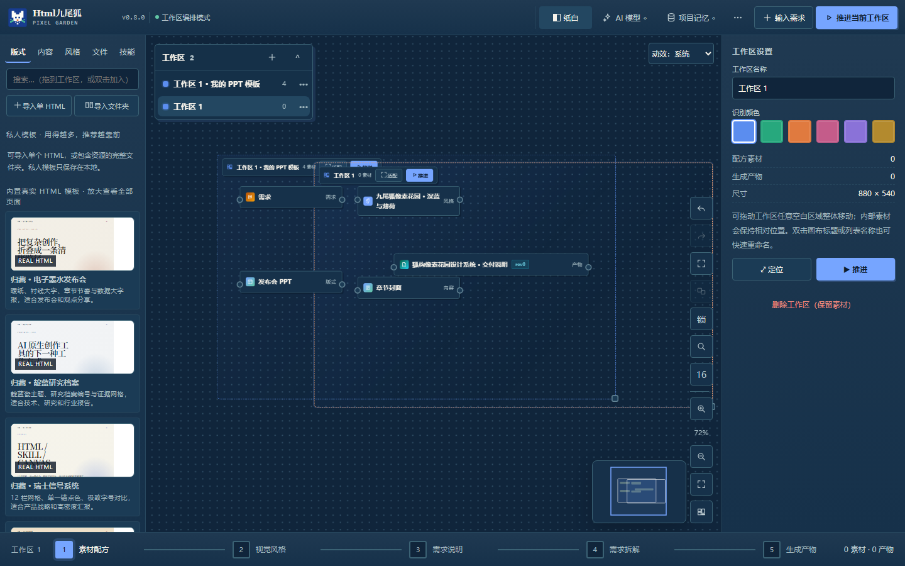<br><b>夜蓝主题（Web 端）</b><br>同一层级的完整暗色主题，对比度达 WCAG AA。</td>
</tr>
<tr>
<td width="50%"><br><b>多工作区管理</b><br>导航卡并存，检查器直接改名与配色。</td>
<td width="50%">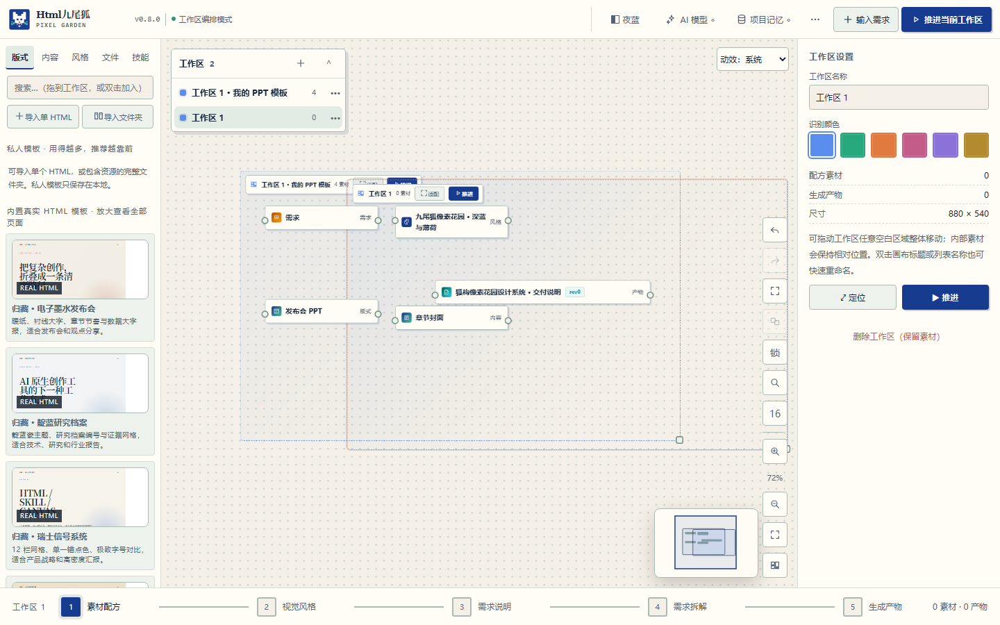<br><b>REAL HTML 模板库</b><br>采纳的网页与模板卡，直接可复用。</td>
</tr>
<tr>
<td width="50%">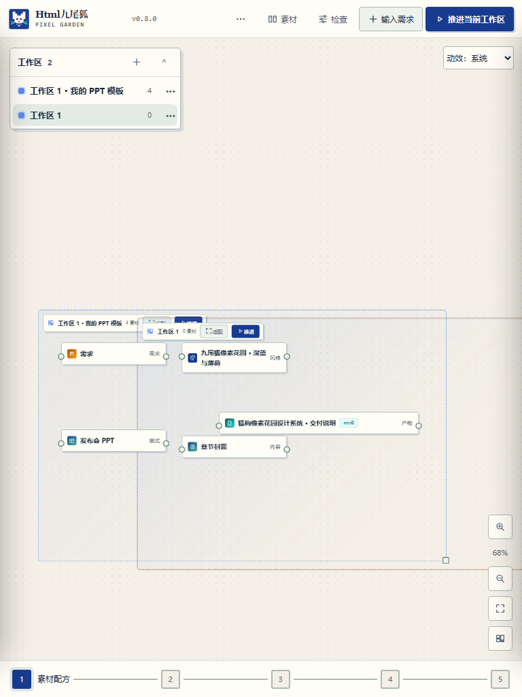<br><b>平板 768 布局</b><br>侧栏折叠为顶栏抽屉，画布语义缩放；步骤条收成圆点不再溢出。</td>
<td width="50%">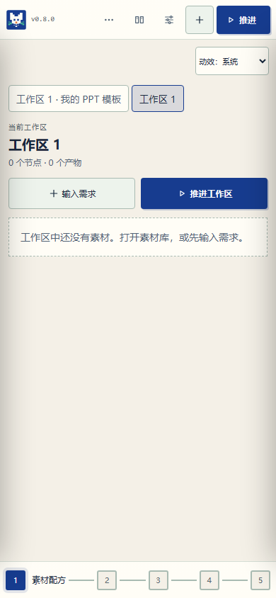<br><b>移动 390 任务视图</b><br>版本徽标在窄屏依旧可见，工作区动作与节点卡片替代缩小画布。</td>
</tr>
</table>

### 🕸 设计吸收

12 个内置源 + URL、ZIP 抓取（SSRF 防护：拒私网、防重绑定、限速），候选先落审核台人工确认；许可三档是代码里强制的，不是标签。

<table>
<tr>
<td width="50%">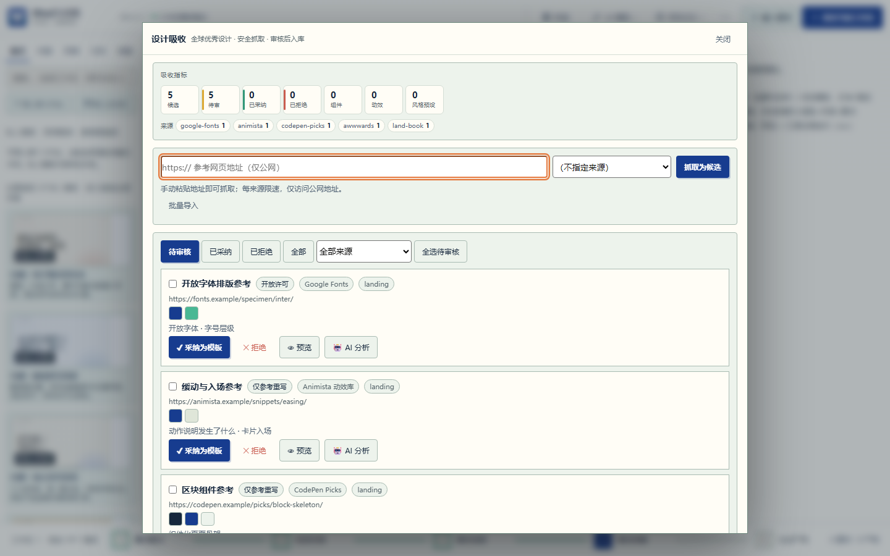<br><b>素材审核台 · 待审核</b><br>许可徽标、令牌色板、骨架大纲与吸收指标。</td>
<td width="50%">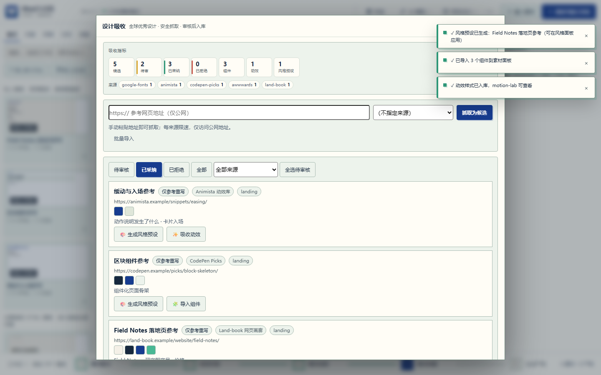<br><b>已采纳 · 六层入库</b><br>风格预设 / 组件 / 动效 / 内容，吸收指标同步更新。</td>
</tr>
</table>

### 📄 Word 导入

贴入 `.docx` 就能开工：本地解析出带出处的块，规则引擎（可接模型）给出意图 / 风格 / 图片计划 / 文案的提案，人在审核台改完再生成。桌面与窄屏都能操作。

<table>
<tr>
<td width="50%"><br><b>桌面 · 提案与边界同屏</b><br>改意图 / 换风格 / 编辑文案 / 增删图片位，主按钮贴底常驻。</td>
<td width="50%">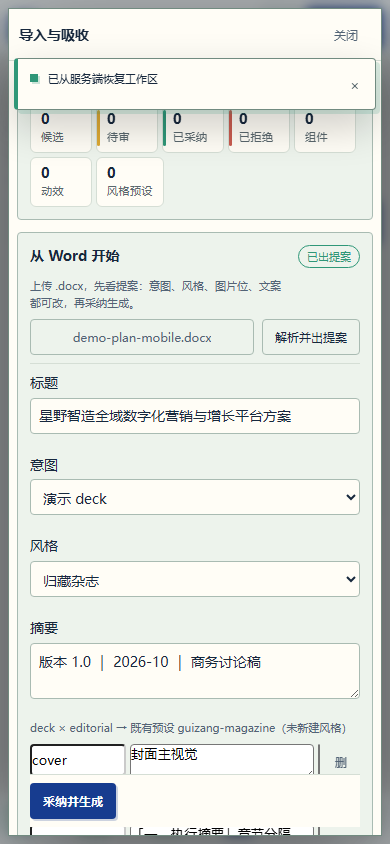<br><b>390px · 单列堆叠</b><br>实测 0 个元素越界，主按钮仍可点到。</td>
</tr>
</table>

### 📊 可编辑 PPTX

deck 产物导出标准 .pptx，PowerPoint / WPS 里文本框真正可编辑；工作台内逐页改写，写回带版本冲突保护。

<table>
<tr>
<td width="50%">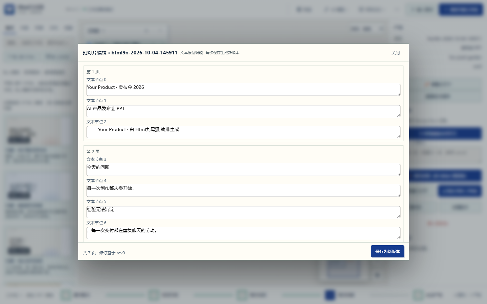<br><b>工作台内幻灯片编辑</b><br>逐页列出可编辑文本节点，保存即新版本。</td>
<td width="50%">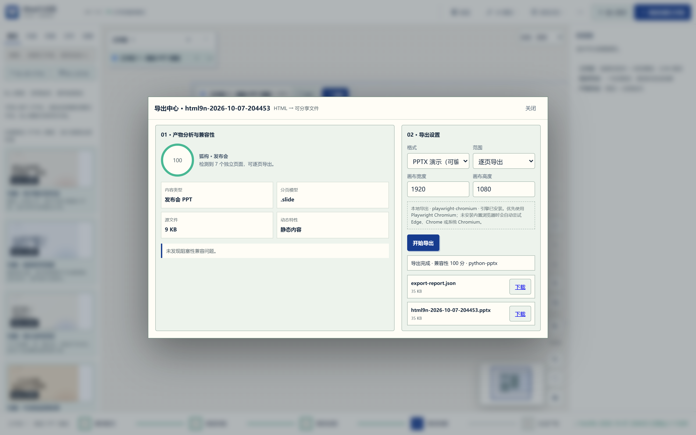<br><b>导出中心 · PPTX 真实导出</b><br>兼容性 100 分 · 7 页 · 24 个可编辑元素 · 0 降级；报告与 pptx 双下载项（本图来自真实导出）。</td>
</tr>
</table>

### 📤 导出中心

PDF / 逐页 PNG / 完整长图 + **Word（.docx）** 四种真实导出 + 兼容性评分报告；deck 产物额外放开可编辑 PPTX。视觉型产物会被如实引导到高保真 PDF / PNG，而不是给一份错形的 Word。

<table>
<tr>
<td width="50%">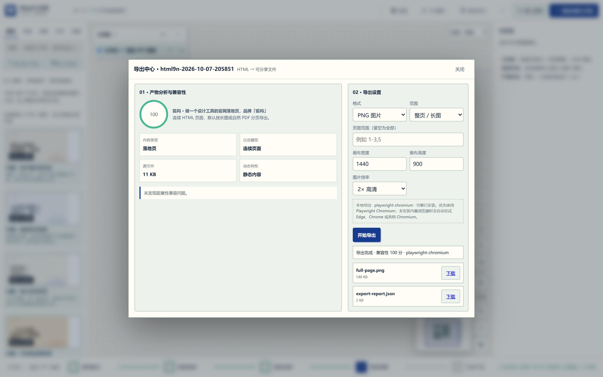<br><b>PNG 长图导出完成</b><br>兼容性 100 分；full-page.png 与 export-report.json 双下载项（真实导出实拍）。</td>
<td width="50%">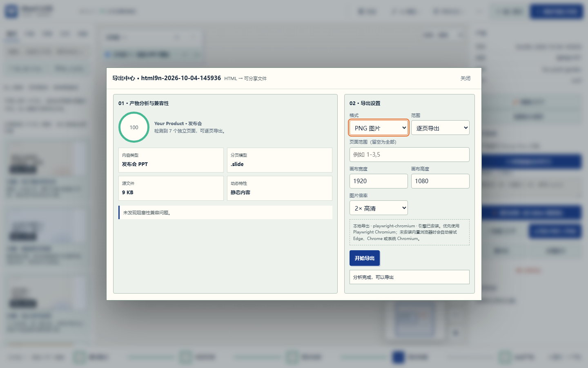<br><b>导出分析就绪</b><br>兼容性评分、分页模型、动态特性与本地引擎状态。</td>
</tr>
</table>

### 🧠 项目记忆 + 版本历史

明确点击「采用此版本并学习」才进入长期记忆，测试稿不污染偏好；反馈、重跑、恢复全留快照，恢复生成新版本、不覆盖历史。

<table>
<tr>
<td width="50%">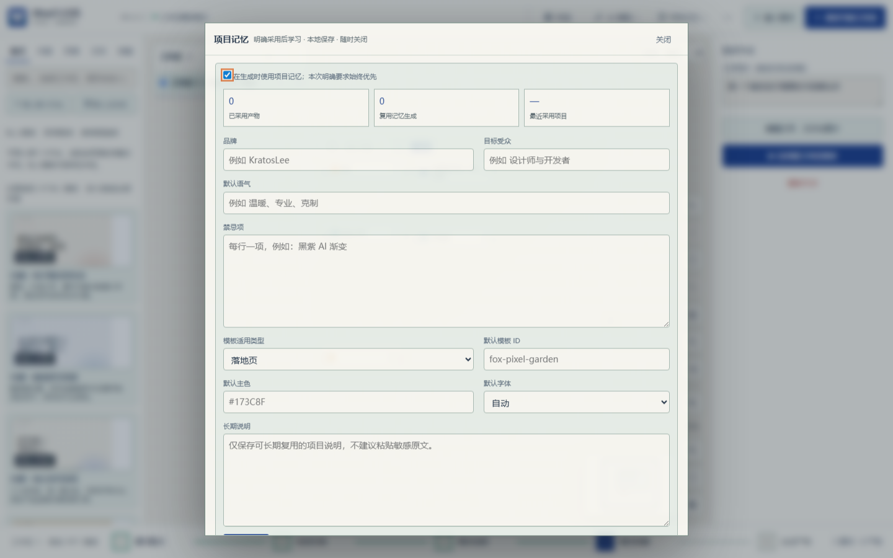<br><b>项目记忆</b><br>品牌、受众、语气、禁忌、模板本地保存复用。</td>
<td width="50%">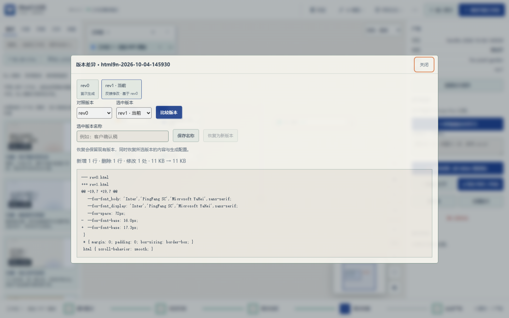<br><b>版本历史与恢复</b><br>命名、行级差异，恢复不覆盖历史。</td>
</tr>
</table>

各板块的完整图文对照（含命令面板、输入入口、经典模式等 23 张实拍）见 [docs/HOMEPAGE-ARCHIVE.md](docs/HOMEPAGE-ARCHIVE.md)。

## 🧰 能力清单

| 能力 | 说明 |
|---|---|
| ✅ 六类内容一句话生成 | 落地页 / 数据看板 / 发布会 PPT / 海报 / 架构文档 / 文档；离线规则引擎兜底，不需要 API Key |
| ✅ 真实 LLM 接入 | MiniMax-M3 / Claude / GPT-4o 与 OpenAI 兼容接口，环境变量自动配置 |
| ✅ 设计吸收 + 网页反向拆解 | 12 个内置源安全抓取；采纳的网页拆成分区直接进生成，许可三档逐字段判定；配置 LLM 后参考类正文改写吸收（paraphrased），忠实度门禁防照抄 |
| ✅ 口语化反馈迭代 | 「颜色深一点、标题大一点」改的是设计令牌；`rev1 / rev2 / …` 历史可恢复 |
| ✅ 可编辑 PPTX + 多格式导出 | 标准 .pptx 真可编辑；PDF / 逐页 PNG / 长图 / **Word（.docx）** + 兼容性评分报告 |
| ✅ 项目记忆 | 明确采用才学习：品牌、受众、语气、模板本地复用，可查看、关闭、清空 |
| ✅ 命令面板与多端布局 | Ctrl+K 直达；桌面 / 平板 / 移动各有一套可读排版 |
| ✅ 隐私边界 | API Key、附件正文、反馈原文不写入记忆与诊断包；导出在本机完成不上传 |
| ✅ 全平台交付 | Windows 安装版/便携版、macOS Apple Silicon 与 Intel 双架构、Linux .deb / .tar.gz / .run、pip wheel、Docker——每份产物 CI 真实启动验证 + 发布前逐字节回读 |

## 🚀 快速开始

```bash
pip install htmlninefox          # 或下载 Release 包 / docker compose up --build
htmlninefox app                  # 打开 http://127.0.0.1:8620
htmlninefox expert "做一个 SaaS 落地页"   # CLI 直接生成
```

Windows（安装版 .exe / 便携版 .zip）、macOS（Apple Silicon / Intel 双架构 .zip）、Linux（.deb / .tar.gz / .run）、pip wheel 与 Docker 全部在 [**最新 Release**](https://github.com/KratosLee-6/Html-ninefox/releases/latest)（全部附 SHA-256，发布前经真实启动验证与逐字节回读）。离线可用，API Key 可选。

## 📜 版本迭代

| 版本 | 日期 | 一句话 |
|---|---|---|
| **v0.8.2** | 2026-10-20 | **界面收敛**：面替代线、按钮系统、动效时钟、空态与图标尺度；设计契约可执行 |
| **v0.8.1** | 2026-10-19 | **Word 导入**：`.docx` 离线解析 → 提案（意图/风格/图片位/文案，带理由）→ 审核台可改 → 一键成页；走既有分块通道，六生成器零改动；DOCX 链 56 条门禁 ＋ 变异 6/6 |
| **v0.8.0** | 2026-10-17 | **DOCX 语义导出**：doc/archdoc 全文 / deck 讲义，降级清单如实；paraphrased「重新改写」；导出矩阵补上 Word 这一格 |
| **v0.7.8** | 2026-10-17 | **C6 收口**：106 处内联 onclick 全量迁 data-action 委托，类型签名表守住「字符串 vs 数字 id」；顺带修掉真点击门禁暴露的芯片点击失灵 |
| **v0.7.7** | 2026-10-12 | **改写吸收（paraphrased）**：配置 LLM 后，参考类网页正文以改写形态进入产物（预览即所得），忠实度门禁防假标签；离线行为不变 |
| **v0.7.6** | 2026-10-12 | **打包矩阵补齐**：新增 macOS Intel 便携包与 Linux .deb，两平台产物真实启动验证、.deb 进字节级回读；应用零变化 |
| **v0.7.5** | 2026-10-12 | **C7 收口**：工作台全局 `state` 七键集中声明 + `FoxState` 只读暴露，静态双向镜/IIFE 锁/执行级核查三门禁；ROADMAP 结构性待办清零 |
| **v0.7.4** | 2026-10-12 | **结构补丁**：C5 ExportError 状态随错误声明 + C1 Runner 接口声明锁拥有权 + 模板渲染一致性（jinja2 extras 不再截走 landing 生成） |
| **v0.7.3** | 2026-10-11 | **「墨水落纸」动效层**：六类产物光带呼吸/墨水标题/滚动显形/光标辉光，reduced-motion 与导出定格三通路 |
| **v0.7.2** | 2026-10-09 | **结构补丁**：IntakeService 提取（P1-7）+ 候选键唯一化（C8）；行为零变化 |
| **v0.7.1** | 2026-10-08 | **体验修复**：平板步骤条溢出、移动徽标隐藏、landing 卡片文案回显——三处都是「修 CSS 断言计算样式」的门禁先把守 |
| **v0.7.0** | 2026-10-07 | **网页反向拆解**：页面分区 → 项目分区，六类全消费；发布前实测修复三个「全绿但坏了」 |
| v0.6.4 | 2026-10-06 | 门禁收口：发布物字节级回读；配色与 blocks 两个真缺陷 |
| v0.6.0 | 2026-10-01 | 设计吸收流水线 + 可编辑 PPTX 两条主线 |
| v0.5.0 | 2026-09-25 | RC3 收口，全平台安装包 |

完整逐版记录：[CHANGELOG](CHANGELOG.md) · 各版发布说明见 [docs/](docs/)。

---

## 🙏 致敬与感谢

本项目的部分能力建立在以下开源工作之上——按许可要求与礼节，一并致谢（详细来源与许可审查见 [DESIGN-SOURCES](docs/DESIGN-SOURCES.md)）：

| 来源 | 许可 | 用在哪里 |
|---|---|---|
| [Univer](https://github.com/dream-num/univer)（dream-num） | Apache-2.0 | v0.6 起的工作台内幻灯片可视化编辑基于 Univer Slides 构建 |
| [python-pptx](https://github.com/scanny/python-pptx)（Steve Canny） | MIT | .pptx 导出的服务端受控映射，文本框在 PowerPoint / WPS 里真正可编辑 |
| [python-docx](https://github.com/python-openxml/python-docx)（python-openxml） | MIT | .docx 语义导出的写出（v0.8）+ 读取（v0.8.1 的 `[docx]` extra） |
| [huashu-art-motion](https://github.com/alchaincyf/huashu-art-motion)（花叔） | MIT | v0.7.0 解说视频的 t2 发布会动画引擎（`film/v070-huashu/`） |
| [Archify](https://github.com/tt-a1i/archify)（tt-a1i） | MIT | README 架构图由 Archify 生成（交互版随仓库发布） |
| [op7418/guizang-product-video-skill](https://github.com/op7418/guizang-product-video-skill) | AGPL-3.0（仅借鉴方法论；SFX 为其原创合成并附使用声明） | 宣传片工程方法论；`film/sfx` 音效来源 |
| [宝玉 baoyu-slide-deck](https://github.com/JimLiu/baoyu-skills)（JimLiu） | MIT | v0.3 PPT 生成模块「AI 画图每页 PPT」的方法参考 |
| [张咋啦 frontend-slides / beautiful-html-templates](https://github.com/zarazhangrui)（zarazhangrui） | MIT | 模板库「避开 AI 紫渐变、稳定出片」的设计哲学来源 |
| [edge-tts](https://github.com/rany2/edge-tts) | 自定义（非标准许可） | 解说视频的人声合成 |
| 归藏 · 花叔 Design · Archify 等社区工作 | — | 设计方法与审美启发（逐项来源见 [DESIGN-SOURCES](docs/DESIGN-SOURCES.md)） |

早期版本的完整致敬长文（含引用原文）保留在 [docs/HOMEPAGE-ARCHIVE.md](docs/HOMEPAGE-ARCHIVE.md#致敬与感谢)。

## 📚 引用与署名

- 代码许可是 **MIT**（见 [LICENSE](LICENSE)）；署名、引用格式与第三方组件边界写在 [NOTICE.md](NOTICE.md)。
- 文章 / 教程 / 论文引用请带版本号，机器可读格式见 [CITATION.cff](CITATION.cff)（GitHub 侧栏会显示「Cite this repository」）。
- 分发或集成时，保留 `LICENSE` 与 `NOTICE.md` 即可满足 MIT 的署名要求；名称、Logo 与 Pixel Garden 视觉不在 MIT 范围内。

```text
KratosLee. (2026). Html九尾狐：人机共驾的 HTML 内容交付工作台（v0.8.0）[计算机软件].
https://github.com/KratosLee-6/Html-ninefox
```

[MIT License](LICENSE) © 2026 **KratosLee · Html九尾狐项目组**
